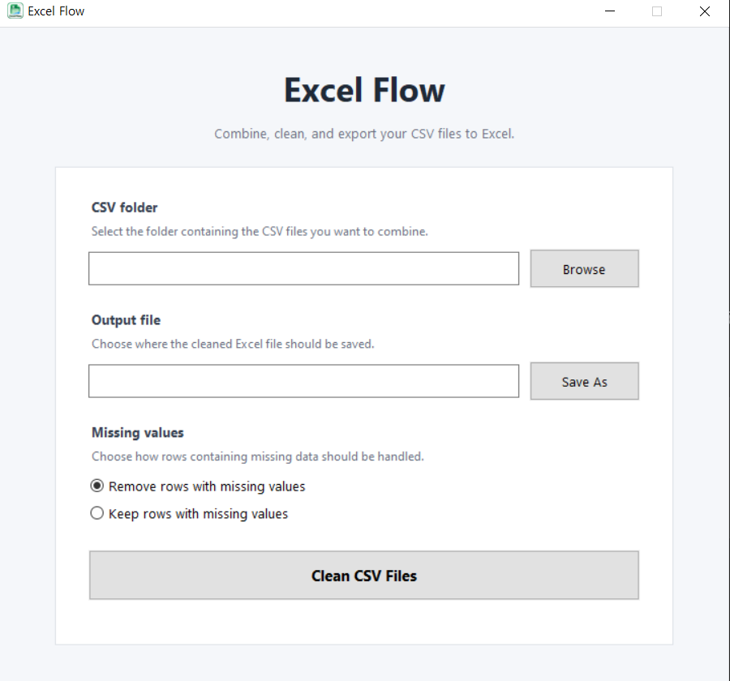

# Excel Flow

**A Windows desktop application for cleaning, combining, and converting CSV files into formatted Excel spreadsheets.**

Excel Flow helps users automate repetitive CSV data-cleaning tasks without writing code or using the command line.

Built with Python, pandas, Tkinter, and openpyxl.

## Features

- Combine multiple CSV files from a selected folder
- Detect the most common column structure and skip mismatched files
- Continue processing when individual CSV files cannot be read
- Remove duplicate rows
- Trim unnecessary whitespace
- Convert empty strings into missing values
- Choose whether to remove rows containing missing values
- Detect numeric values, including comma-separated numbers and dollar amounts
- Detect common date formats
- Export cleaned data to an Excel `.xlsx` file
- Apply bold headers, filters, frozen header rows, and adjusted column widths
- Display a processing summary in the desktop interface

## Screenshots



## How It Works

1. Launch Excel Flow.
2. Select the folder containing your CSV files.
3. Choose the destination for the Excel output.
4. Select whether to remove rows with missing values.
5. Click **Clean CSV Files**.
6. Review the processing summary and generated Excel workbook.

The application selects the most common CSV column structure, combines matching files, cleans the data, and exports the result.

## Tech Stack

| Technology | Purpose |
|---|---|
| Python | Core application logic |
| pandas | CSV processing, validation, and data cleaning |
| Tkinter / ttk | Windows desktop interface |
| openpyxl | Excel formatting and workbook generation |
| PyInstaller | Standalone Windows executable packaging |

## Project Structure

```text
excel-flow/
├── main.py
├── gui.py
├── sample_data/
├── requirements.txt
├── README.md
└── .gitignore
```

`main.py` contains the data-cleaning logic, while `gui.py` provides the desktop interface.

## Run From Source

Requires Python and the dependencies listed in `requirements.txt`.

```bash
git clone https://github.com/jsyoo1229/excel-flow.git
cd excel-flow
python -m venv .venv
```

On Windows PowerShell:

```powershell
.\.venv\Scripts\Activate.ps1
pip install -r requirements.txt
python gui.py
```

## Windows Application

Excel Flow is also available as a standalone Windows executable.

End users do not need to install Python, pandas, or use a terminal.

**[Get Excel Flow on Gumroad](https://9644227418474.gumroad.com/l/excel-flow)**

## Limitations

- Designed for CSV files with compatible column structures.
- Files with columns that do not match the most common structure are skipped.
- Numeric conversion supports common formats such as `1,200` and `$1,200`, but not every international currency format.
- Date detection may not correctly interpret every date format.
- Generated results should be reviewed before use in critical workflows.

## Author

Jinsun Yoo

**Version 1.0**